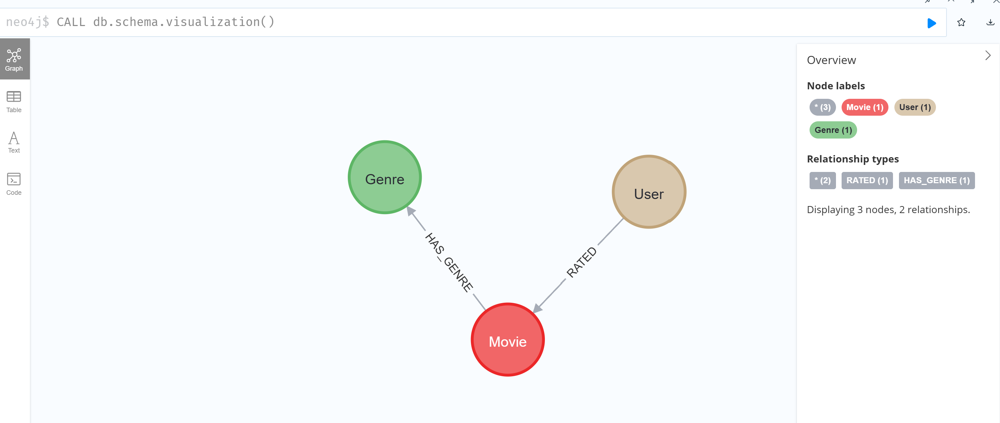
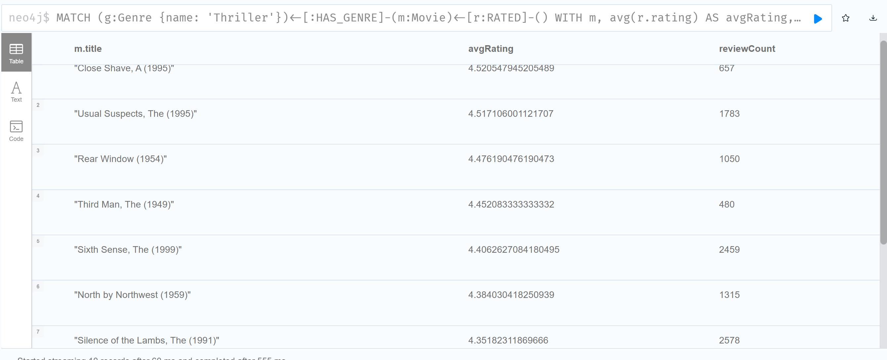
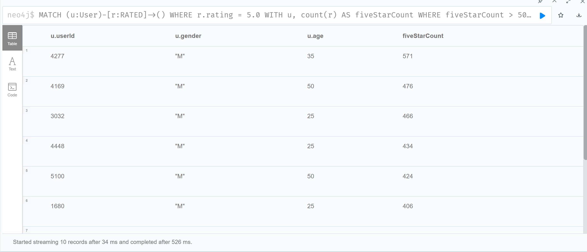
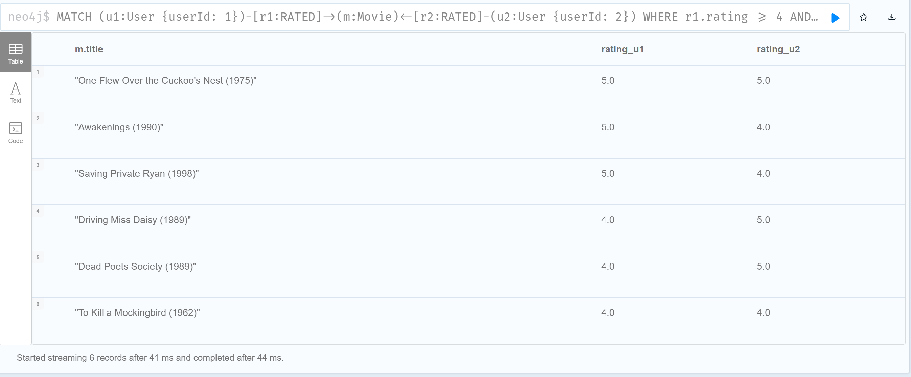
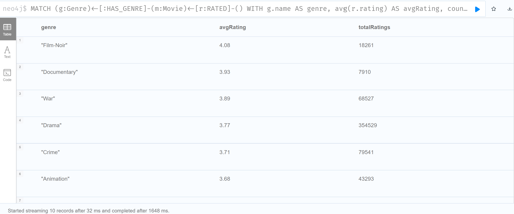
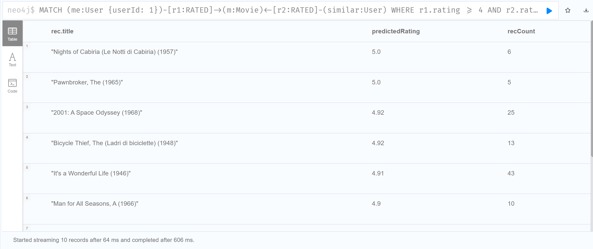
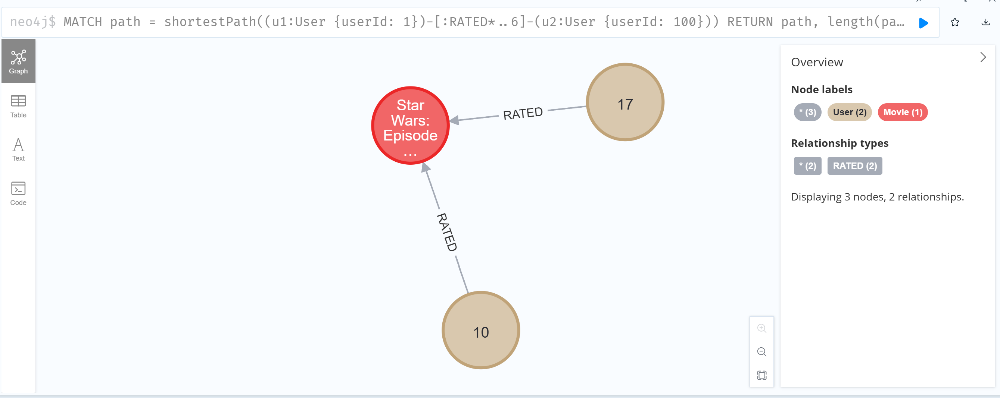
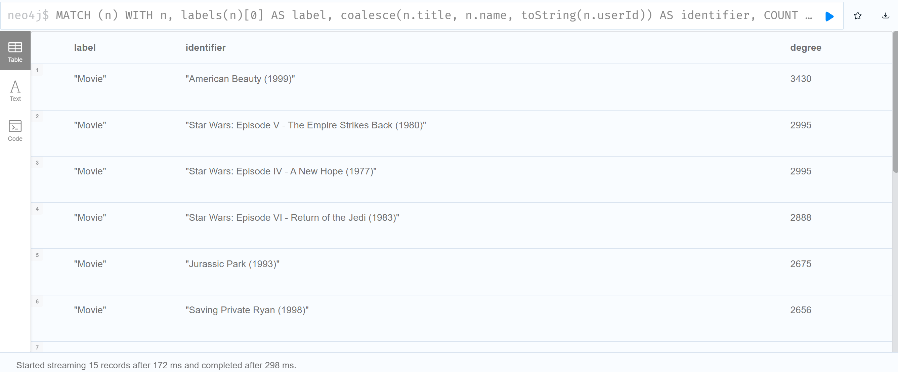
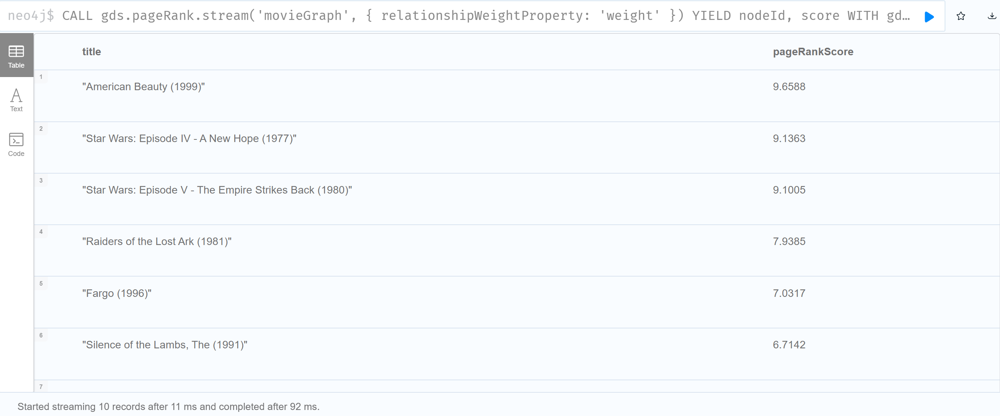
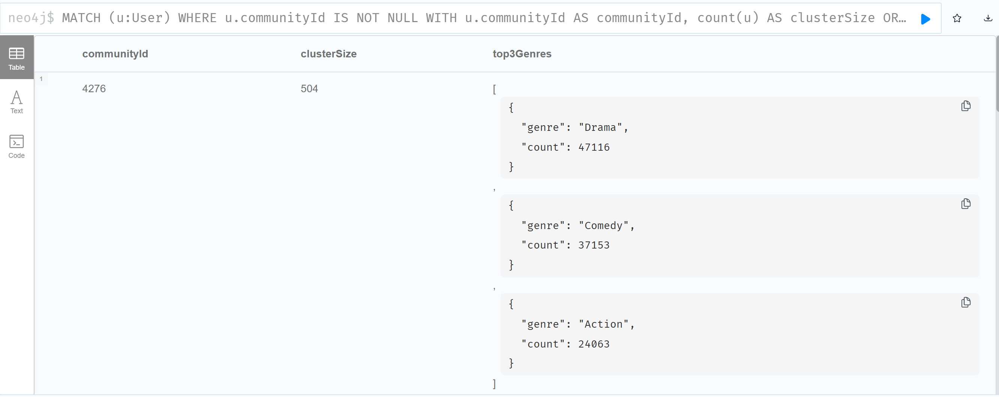

# Graph-Based Recommendation Engine (MovieLens 1M)

Цей проєкт демонструє побудову рекомендаційної системи на основі графової бази даних Neo4j з використанням датасету MovieLens 1M та бібліотеки Graph Data Science (GDS).

## Структура проєкту
- `docker-compose.yml` — конфігурація для локального запуску Neo4j з плагінами APOC та GDS.
- `convert.py` — скрипт конвертації `.dat` (Latin-1, `::`) у `.csv` (UTF-8, `,`).
- `import/` — папка з підготовленими CSV-файлами (не комітиться в Git).
- `queries/` — Cypher-скрипти для завантаження (`part2_load.cypher`), аналізу (`part3.cypher`), пошуку супервузлів (`part4_supernodes.cypher`) та GDS-алгоритмів (`part5_gds.cypher`).
- `README.md` — цей файл з описом, схемами та відповідями на теоретичні запитання.

---

## Частина 1: Проєктування схеми графа
### ASCII-діаграма схеми
```text
(User {userId, gender, age, occupation})
   │
   │ [:RATED {rating, timestamp}]
   ▼
(Movie {movieId, title}) ──[:HAS_GENRE]──> (Genre {name})
```



Відповіді на запитання:
1. Які сутності стали вузлами, а які — ребрами?
User, Movie та Genre стали вузлами, оскільки це незалежні сутності з власними атрибутами. RATED та HAS_GENRE стали ребрами, оскільки вони описують зв'язок між сутностями.
2. Оцінка користувача: ребро чи окремий вузол?
Вибрано ребро (User)-[:RATED {rating, timestamp}]->(Movie).
Аргументація: Оцінка є чистою властивістю взаємодії між двома сутностями. Створення окремого вузла Rating додало б зайву складність (додаткові ребра HAS_RATING), збільшило б розмір графа та сповільнило б обходи шляхів, не надаючи жодних нових аналітичних можливостей для цього датасету.
3. Чому жанри — окремі вузли, а не список у властивості?
Зберігання жанрів як окремих вузлів (Genre) дозволяє легко виконувати запити на кшталт "знайти всі фільми жанру X" або "знайти спільні жанри двох фільмів" без необхідності парсити рядки (split) або використовувати повнотекстовий пошук. Це робить запити швидшими та семантично чистішими.

Частина 2: Завантаження даних
Використання MERGE гарантує ідемпотентність (захист від дублікатів при повторному запуску). 
Завантаження 1 млн оцінок розбито на батчі по 10000 рядків із параметром parallel: false (це запобігає блокуванням Deadlock при одночасному записі зв'язків до одного й того самого фільму).

Частина 3: Запити різної складності

Запит 1. Знайти всі фільми жанру «Thriller» із середнім рейтингом вище 4.0:


Запит 2. Знайти користувачів, які поставили оцінку 5 більш ніж 50 фільмам:


Запит 3. Знайти фільми, які обидва користувачі (наприклад, userId=1 і userId=2) оцінили високо (рейтинг ≥ 4):


Запит 4. Знайти жанри, чиї фільми стабільно отримують високі оцінки — середній рейтинг і кількість оцінок:


Запит 5. Рекомендація «користувачі зі схожими смаками також дивилися»: для заданого користувача знайти фільми, які він ще не дивився, але високо оцінили користувачі з подібними смакам


Запит 6. Знайти найкоротший ланцюжок зв’язку між двома користувачами через спільні фільми:


Відповіді на запитання:
3.1. Що означає довжина шляху в даному контексті?
Один хоп (довжина 1) — це зв'язок User→Movie. Шлях довжини 2 (User-Movie-User) означає, що два користувачі оцінили один і той самий фільм.

3.2. Як інтерпретувати шлях довжини 4? Довжини 6?
Довжина 4 (User-Movie-User-Movie-User) означає, що користувачі не мають спільних фільмів, але вони обидва оцінили фільми, які дивився якийсь третій (проміжний) користувач. Довжина 6 додає ще один рівень опосередкованості через двох проміжних користувачів.
* **Довжина 4 (`User 1` → `Movie A` ← `User X` → `Movie B` ← `User 2`):** Користувачі не мають спільних фільмів напряму, але пов'язані через одного проміжного користувача (`User X`), який дивився `Movie A` (як `User 1`) та `Movie B` (як `User 2`).
* **Довжина 6 (`User 1` → `Movie A` ← `User X` → `Movie B` ← `User Y` → `Movie C` ← `User 2`):** Зв'язок проходить через **двох проміжних користувачів** (`User X`, `User Y`) та **три фільми**, що свідчить про більш віддалений перетин уподобань.


Частина 4: Виявлення супервузлів

Крок 1. Знайдіть вузли з аномально великою кількістю ребер:


Крок 2: Перевірити кількість зв'язків у вузлів жанрів (потенційні супервузли)


4.1. Які вузли виявилися супервузлами? Скільки у них зв’язків?

У датасеті MovieLens 1M виявлено три категорії вузлів із високим ступенем зв'язності (супервузлів):
• Популярні фільми (:Movie): Наприклад, «American Beauty (1999)» має 3 428 оцінок (RATED), «Star Wars: Episode IV - A New Hope (1977)» — 2 991, «Star Wars: Episode V» — 2 990, «Star Wars: Episode VI» — 2 883, «Jurassic Park (1993)» — 2 672.
• Надактивні користувачі (:User): Деякі користувачі оцінили понад дві тисячі фільмів (наприклад, userId: 4169 має 2 314 зв'язків RATED, userId: 1680 — 1 850).
• Популярні жанри (:Genre): Жанр Drama пов'язаний із 1 603 фільмами (HAS_GENRE), Comedy — із 1 200, Action — із 503.

4.2. Чому запит, що зачіпає такий вузол, працює повільніше, ніж запит по «звичайному» вузлу з тими самими індексами?

• Індекси допомагають лише на старті (пошук точки входу): Індекс швидко знаходить сам вузол (наприклад, Drama чи American Beauty), але не прискорює обхід його сусідів.
• Вибухове зростання кількості шляхів (Fan-out / Cartesian Explosion): Щойно запит потрапляє на супервузол (наприклад, userId: 1 → Star Wars → інші користувачі), він змушений перебрати тисячі вихідних ребер і завантажити в оперативну пам'ять (Page Cache) тисячі сусідніх вузлів. Якщо в запиті є два хопи через супервузли (наприклад, пошук спільних фільмів), кількість проміжних комбінацій зростає квадратично (\(N^{2}\)).
• Блокування при записі: Під час додавання нових ребер до супервузла виникає конкуренція за блокування (Lock Contention) на самому вузлі.

4.3. Яку конкретну стратегію ви б застосували для цього датасету? Що робити з жанровими вузлами?

Для вузлів :Genre (та інших довідкових категорій із низькою кардинальністю) оптимальною стратегією є денормалізація — перенесення жанрів із окремих вузлів у властивість-масив (список) самого фільму (наприклад, m.genres = ['Action', 'Thriller']) замість зв'язків (:Movie)-[:HAS_GENRE]->(:Genre):
• Чому це працює: У графі зникають 18 «штучних» супервузлів :Genre та тисячі зайвих ребер HAS_GENRE. Якщо потрібно знайти всі трилери з високим рейтингом, замість обходу тисяч зв'язків від супервузла Genre, ми просто фільтруємо список властивостей (WHERE 'Thriller' IN m.genres), що суттєво зменшує навантаження на пам'ять та кількість обходів графа.
• Додатково для надпопулярних фільмів/користувачів: Можна застосовувати попередню агрегацію (зберігати m.avgRating та m.ratingCount як властивості вузла :Movie, щоб не перераховувати 3 400 ребер при кожному запиті) або розділення типів зв'язків (Relationship Splitting) — наприклад, розділити загальний зв'язок :RATED на :LIKED (оцінки 4–5) та :DISLIKED (оцінки 1–2), щоб під час побудови рекомендацій ігнорувати негативні оцінки ще на рівні типу ребра.


Частина 5: Графові алгоритми (GDS)
(Див. файл queries/part5_gds.cypher)

5.1. PageRank на графі фільмів


Відповіді на запитання:
5.1 PageRank:
Високий PageRank для фільму в цьому графі означає не просто "популярність" (кількість переглядів), а "авторитетність". Фільм отримує високий бал, якщо його високо оцінюють користувачі, які самі є "авторитетними" (тобто їхні оцінки збігаються з оцінками багатьох інших користувачів за багато інших фільмів). Це фільтрує випадкові хіти на користь фундаментально якісних фільмів.

5.2. Виявлення спільнот (Louvain)



1. Чи відповідають отримані кластери інтуїтивним групам?
Лише частково. У найбільших спільнотах (кластери 4276, 2908, 2029, 1210) домінують Drama, Comedy та Action. Це пояснюється перекосом (дисбалансом) самого датасету MovieLens 1M: драма та комедія — наймасовіші жанри, тому активні кіномани дивляться їх у великій кількості незалежно від вузьких уподобань.
Проте якщо придивитися до пропорцій та другорядних жанрів, відмінності все ж простежуються:
• Кластер 4276 (504 користувачі — найбільший «мейнстрім-кластер»): Чітка перевага серйозного кіно (Drama — 47 116 оцінок, значний відрив від Comedy — 37 153).
• Кластер 2908 (186 користувачів — «фанати розважального кіно та екшену»): На перше місце виходить Comedy (19 310), а Action (17 195) майже наздоганяє драму (17 735).
• Кластер 2029 (169 користувачів — «цінителі саспенсу та трилерів»): На відміну від усіх інших великих груп, сюди в трійку замість бойовиків увірвався жанр Thriller (7 894 оцінки), а частка драми відносно комедії тут найвища.
• Кластер 2 (1 користувач — ізольований вузол): Оскільки під час побудови графа userSimilarity ми обмежили вибірку найсильнішими зв'язками (LIMIT 20000), користувачі без достатньої кількості спільних «п'ятірок» з іншими залишилися в окремих мікрокластерах розміром 1 (наприклад, цей користувач віддає перевагу Adventure).

2. Як ви це перевірили?
1. Запустили алгоритм Louvain у режимі .write на зваженому графі схожості користувачів (userSimilarity), зберігши ідентифікатор спільноти у властивість u.communityId.
2. Згрупували користувачів за communityId, визначивши розмір кожного кластера (clusterSize).
3. Для 5 найбільших кластерів зробили обхід (u:User)-[:RATED]->(m:Movie)-[:HAS_GENRE]->(g:Genre) із фільтрацією за високими оцінками (r.rating >= 4) та підрахували топ-3 найпопулярніші жанри для кожної групи.

5.3 Dijkstra (Найкоротший шлях):

Тут застосовано 2 варіанти:
Варіант 1
З використанням проекції з попереднього пункту Louvain повернув порожню таблицю (no records).
Пояснення: Попередній крок (Louvain): із 6 040 користувачів у великі зв'язні кластери потрапили лише близько 850 найактивніших кіноманів (решта ~5 100 користувачів залишилися ізольованими без жодного ребра SIMILAR). Оскільки алгоритму Дейкстри не існує шляху між ізольованими вузлами, процедура dijkstra.stream просто не повертає рядків.

Варіант 2
Беремо 10 реальних користувачів, які точно мають зв'язки SIMILAR:cypher
MATCH (u:User)-[:SIMILAR]-()
RETURN DISTINCT u.userId AS activeUserId
LIMIT 10;


"Тісний світ": Так, граф дуже щільний. Між будь-якими двома активними користувачами шлях зазвичай знаходиться за 2-4 хопа.
Гіпотеза шести рукостискань: Підтверджується з великим запасом. У середньому довжина шляху між довільними користувачами через спільні смаки становить 2 або 4 (тобто 1 або 2 проміжних людини).


Частина 6: Аналіз і висновки
Граф vs SQL:
Запит 5 (рекомендації "схожі користувачі дивилися") і Запит 6 (найкоротший шлях) були б надзвичайно складними в SQL.
Приклад для Запиту 6 в SQL: Потрібні були б рекурсивні CTE (Common Table Expressions) з WITH RECURSIVE, що для мільйона рядків працює вкрай повільно і важко підтримується. У Cypher це робиться однією конструкцією shortestPath.
Де граф програє?
Реляційна модель краще підходить для суто табличних агрегацій та звітності. Наприклад, "експортувати таблицю всіх користувачів з їхнім середнім чеком і демографією для BI-дашборду". SQL GROUP BY працює швидше і передбачуваніше для таких плоских звітів, ніж обхід графа.
Покращення схеми:
Для Запиту 4 (жанри з високим рейтингом): Додати властивість avgRating безпосередньо на вузол Genre і оновлювати її тригером або батчем. Це перетворить запит з O(N) обходу всіх фільмів на O(1) читання властивості.
Для Запиту 5 (рекомендації): Матеріалізація ребер User-SIMILAR_TO-User (як зроблено в GDS) значно прискорить пошук "схожих користувачів" у реальному часі, усуваючи необхідність щоразу обчислювати спільні фільми "на льоту".
